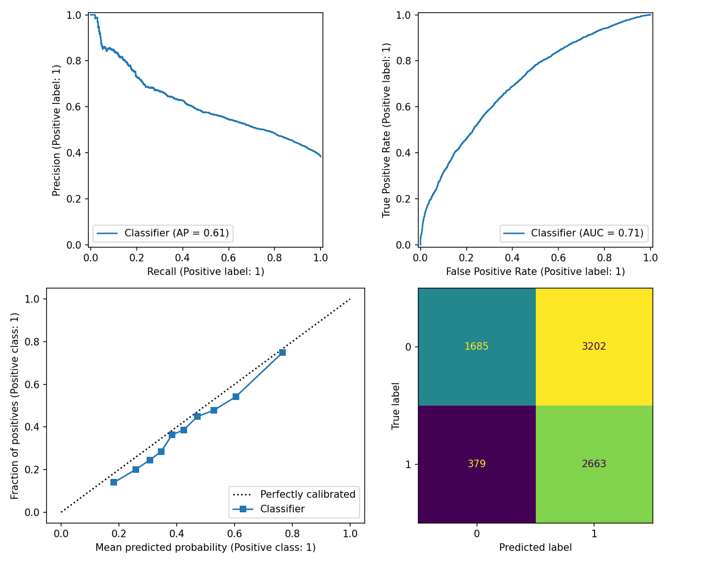
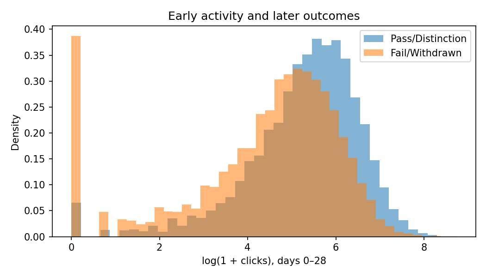
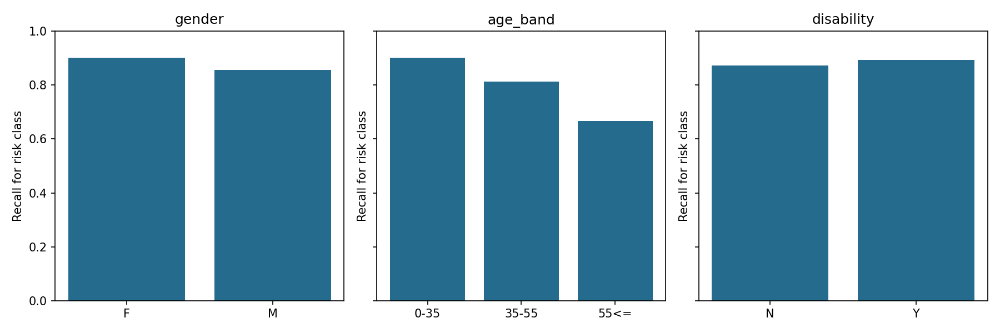

# OULAD day-28 experiment

Source archive SHA-256: `f2ed1902616c1fe8d2824d872c0b7d2d72be435bf0124d077044fe4be2c6d3e4`

Train / validation / test enrolments: 11797 / 5832 / 7929.

Selected model: **forest**; validation-selected threshold: 0.310.

| Test measure | Value |
|---|---:|
| average_precision | 0.6114 |
| roc_auc | 0.7052 |
| brier | 0.2079 |
| precision | 0.4540 |
| recall | 0.8754 |
| f1 | 0.5980 |

See metrics.json for student-bootstrap intervals and baseline, fairness.csv for group denominators and suppressed groups, and module_metrics.csv for module shift.

The selected threshold flags 74.0% of test enrolments, with 45.4% precision and 65.5% false-positive rate. This is a high-volume review policy, not a practical support capacity recommendation.

The unsuppressed age-band recall gap is 23.6 percentage points. Group errors differ; inspect denominators before interpreting gaps. No fairness guarantee follows from these results.

These are retrospective associations on historical UK distance-learning cohorts. They do not establish that outreach improves outcomes or that the model is fair. Excluding overlapping students changes the evaluation population. Grade timestamps are unavailable, so assessment scores are excluded. No deployment is authorized by these results.
